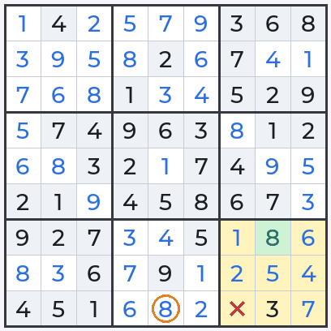

<!-- Written by tools/walkthrough.py classic: edit the script, not this page. -->
# Classic, step 42: the 8 in box 9

**Step 42 of 43** · [← Step 41](step-41.md) · [All steps](../classic.md#worked-example-the-whole-puzzle) · [Step 43 →](step-43.md)

Box 9 needs an 8. r9c7: row 9 has one (r9c5). Only **r7c8** is left: **r7c8 = 8**.

**Step 42 of 43** · [← Step 41](step-41.md) · [All steps](../classic.md#worked-example-the-whole-puzzle) · [Step 43 →](step-43.md)
