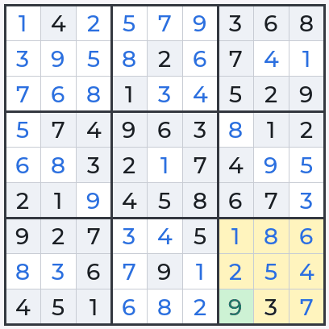

<!-- Written by tools/walkthrough.py classic: edit the script, not this page. -->
# Classic, step 43: the 9 in box 9

**Step 43 of 43** · [← Step 42](step-42.md) · [All steps](../classic.md#worked-example-the-whole-puzzle) · [All steps](../classic.md#worked-example-the-whole-puzzle)

Box 9 needs a 9, and r9c7 is its last empty cell: **r9c7 = 9**.

Solved.

**Step 43 of 43** · [← Step 42](step-42.md) · [All steps](../classic.md#worked-example-the-whole-puzzle) · [All steps](../classic.md#worked-example-the-whole-puzzle)
