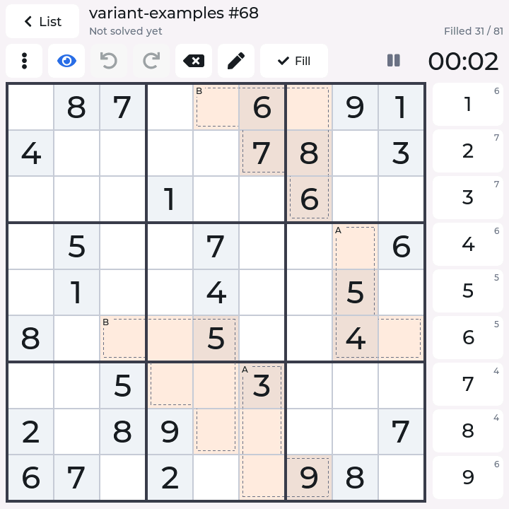
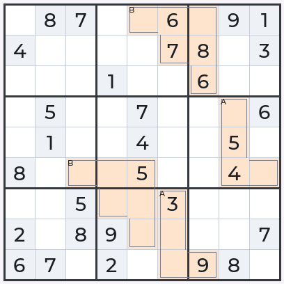

# Clone Sudoku

[← All variants](README.md) · [Puzzles](../features-puzzles.md) · [How to play](../how-to-play.md)

## The rules

[Classic](classic.md) rules, and **pairs of shaded areas of the same shape**: one area is the other moved (not turned), and **each cell holds the same digit as the cell in the same place in the other area**, its clone. The two areas of a pair carry the same letter (A, B, C). A cell and its clone never share a row, column or box.

## On the board

- The areas are tinted, outlined with a dashed line, and lettered in their first cell: the two areas with one letter are a pair.
- A cell and its clone holding different digits turn red.
- The grader and hints know one step: a cell keeps only what its clone can still be; the hint marks both cells and names the digits left.
- **Puzzles → ⋮ → New puzzle → Grids → Clone**: two pairs of areas of 4 to 6 cells (Hard and Expert: three). Every digit in an area also stands in its clone, so the puzzles keep fewer givens than Classic's.

## How to solve it

- **Copy every digit across.** A digit in an area belongs in its clone too: fill those first.
- **Share what's ruled out.** If a cell can't be 4 (its row has one), its clone can't be either: the two cells together see two rows, two columns and two boxes.
- **Count both.** A digit missing from both areas of a pair must fit a cell whose row, column and box, and its clone's, all lack it.

## Worked example

**variant-examples #68**, Clone Sudoku Easy (see [Classic](classic.md#worked-example-the-whole-puzzle) for how to import the examples; cells are written r*row*c*column*). Its areas:

- **A**: r6c9, r6c8, r5c8, r4c8, and its clone r9c7, r9c6, r8c6, r7c6 (moved 3 rows down and 2 columns left);
- **B**: r1c6, r1c7, r2c7, r2c6, r1c5, r3c7, and its clone r6c4, r6c5, r7c5, r7c4, r6c3, r8c5 (moved 5 rows down and 2 columns left).

**Step 1: r6c4.** Row 6 has 8, 5 and 4; column 4 has 1, 9 and 2; box 5 has 7, 4 and 5. By the Classic rules r6c4 could be 3 or 6. It's the clone of r1c6, a given 6. **r6c4 = 6**.

**Step 2: r6c9.** By the Classic rules it could be 2 or 9 (row 6 has 8, 6, 5 and 4; column 9 has 1, 3, 6 and 7). It's the clone of r9c7, a given 9. **r6c9 = 9**.

**Step 3: r8c5.** By the Classic rules it could be 1 or 6 (row 8 has 2, 8, 9 and 7; column 5 has 7, 4 and 5; box 8 has 3, 9 and 2). It's the clone of r3c7, a given 6. **r8c5 = 6**.

## The whole puzzle, step by step

<!-- walkthrough -->
<!-- Written by tools/walkthrough.py clone-sudoku: edit the script, not this part. -->

The whole puzzle, from the start to the last cell: 50 steps, each one a single (one place left for a digit, or one digit left for a cell), taken in the order a box's single comes first, so not quite the order of the worked example above. Each step has a page of its own, with **Previous** and **Next**: pick its number below. In each picture, the unit the step looks at is tinted yellow (for a cell with one digit left: its row, column and box), the new digit is on green, the digits that rule cells out have an **orange ring**, and the empty cells they rule out a **red cross**. Givens are on grey, digits from earlier steps in blue.

| [1](clone-sudoku/step-01.md) | [2](clone-sudoku/step-02.md) | [3](clone-sudoku/step-03.md) | [4](clone-sudoku/step-04.md) | [5](clone-sudoku/step-05.md) | [6](clone-sudoku/step-06.md) | [7](clone-sudoku/step-07.md) | [8](clone-sudoku/step-08.md) | [9](clone-sudoku/step-09.md) | [10](clone-sudoku/step-10.md) |
|:-:|:-:|:-:|:-:|:-:|:-:|:-:|:-:|:-:|:-:|
| [11](clone-sudoku/step-11.md) | [12](clone-sudoku/step-12.md) | [13](clone-sudoku/step-13.md) | [14](clone-sudoku/step-14.md) | [15](clone-sudoku/step-15.md) | [16](clone-sudoku/step-16.md) | [17](clone-sudoku/step-17.md) | [18](clone-sudoku/step-18.md) | [19](clone-sudoku/step-19.md) | [20](clone-sudoku/step-20.md) |
| [21](clone-sudoku/step-21.md) | [22](clone-sudoku/step-22.md) | [23](clone-sudoku/step-23.md) | [24](clone-sudoku/step-24.md) | [25](clone-sudoku/step-25.md) | [26](clone-sudoku/step-26.md) | [27](clone-sudoku/step-27.md) | [28](clone-sudoku/step-28.md) | [29](clone-sudoku/step-29.md) | [30](clone-sudoku/step-30.md) |
| [31](clone-sudoku/step-31.md) | [32](clone-sudoku/step-32.md) | [33](clone-sudoku/step-33.md) | [34](clone-sudoku/step-34.md) | [35](clone-sudoku/step-35.md) | [36](clone-sudoku/step-36.md) | [37](clone-sudoku/step-37.md) | [38](clone-sudoku/step-38.md) | [39](clone-sudoku/step-39.md) | [40](clone-sudoku/step-40.md) |
| [41](clone-sudoku/step-41.md) | [42](clone-sudoku/step-42.md) | [43](clone-sudoku/step-43.md) | [44](clone-sudoku/step-44.md) | [45](clone-sudoku/step-45.md) | [46](clone-sudoku/step-46.md) | [47](clone-sudoku/step-47.md) | [48](clone-sudoku/step-48.md) | [49](clone-sudoku/step-49.md) | [50](clone-sudoku/step-50.md) |

Solved.

<!-- /walkthrough -->
