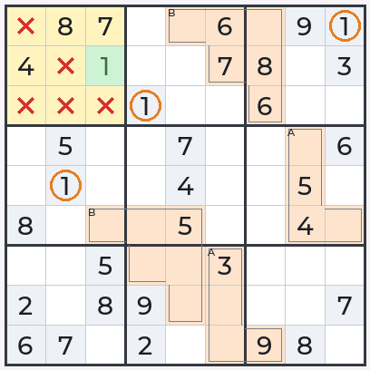

<!-- Written by tools/walkthrough.py clone-sudoku: edit the script, not this page. -->
# Clone Sudoku, step 1: the 1 in box 1

**Step 1 of 50** · [← The start](../clone-sudoku.md#the-whole-puzzle-step-by-step) · [All steps](../clone-sudoku.md#the-whole-puzzle-step-by-step) · [Step 2 →](step-02.md)

Box 1 needs a 1. r1c1: row 1 has one (r1c9). r2c2: column 2 has one (r5c2). r3c1, r3c2 and r3c3: row 3 has one (r3c4). Only **r2c3** is left: **r2c3 = 1**.

**Step 1 of 50** · [← The start](../clone-sudoku.md#the-whole-puzzle-step-by-step) · [All steps](../clone-sudoku.md#the-whole-puzzle-step-by-step) · [Step 2 →](step-02.md)
