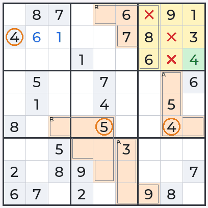

<!-- Written by tools/walkthrough.py clone-sudoku: edit the script, not this page. -->
# Clone Sudoku, step 3: the 4 in box 3

**Step 3 of 50** · [← Step 2](step-02.md) · [All steps](../clone-sudoku.md#the-whole-puzzle-step-by-step) · [Step 4 →](step-04.md)

Box 3 needs a 4. r2c8: row 2 has one (r2c1). r3c8: column 8 has one (r6c8). r1c7: its clone, r6c5, is 5: they hold the same digit. Only **r3c9** is left: **r3c9 = 4**.

**Step 3 of 50** · [← Step 2](step-02.md) · [All steps](../clone-sudoku.md#the-whole-puzzle-step-by-step) · [Step 4 →](step-04.md)
