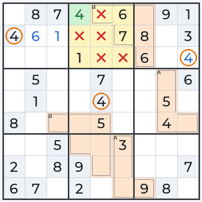

<!-- Written by tools/walkthrough.py clone-sudoku: edit the script, not this page. -->
# Clone Sudoku, step 4: the 4 in box 2

**Step 4 of 50** · [← Step 3](step-03.md) · [All steps](../clone-sudoku.md#the-whole-puzzle-step-by-step) · [Step 5 →](step-05.md)

Box 2 needs a 4. r1c5: column 5 has one (r5c5). r2c4 and r2c5: row 2 has one (r2c1). r3c5 and r3c6: row 3 has one (r3c9). Only **r1c4** is left: **r1c4 = 4**.

**Step 4 of 50** · [← Step 3](step-03.md) · [All steps](../clone-sudoku.md#the-whole-puzzle-step-by-step) · [Step 5 →](step-05.md)
