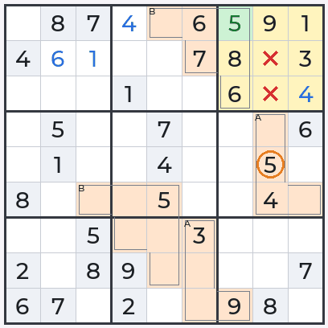

<!-- Written by tools/walkthrough.py clone-sudoku: edit the script, not this page. -->
# Clone Sudoku, step 5: the 5 in box 3

**Step 5 of 50** · [← Step 4](step-04.md) · [All steps](../clone-sudoku.md#the-whole-puzzle-step-by-step) · [Step 6 →](step-06.md)

Box 3 needs a 5. r2c8 and r3c8: column 8 has one (r5c8). Only **r1c7** is left: **r1c7 = 5**.

**Step 5 of 50** · [← Step 4](step-04.md) · [All steps](../clone-sudoku.md#the-whole-puzzle-step-by-step) · [Step 6 →](step-06.md)
