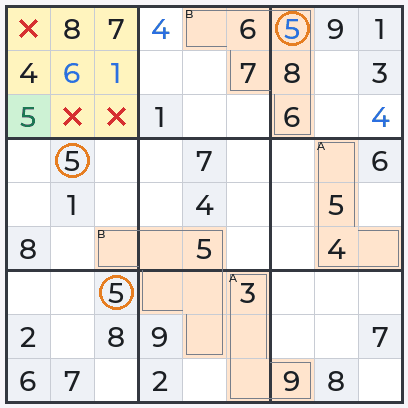

<!-- Written by tools/walkthrough.py clone-sudoku: edit the script, not this page. -->
# Clone Sudoku, step 6: the 5 in box 1

**Step 6 of 50** · [← Step 5](step-05.md) · [All steps](../clone-sudoku.md#the-whole-puzzle-step-by-step) · [Step 7 →](step-07.md)

Box 1 needs a 5. r1c1: row 1 has one (r1c7). r3c2: column 2 has one (r4c2). r3c3: column 3 has one (r7c3). Only **r3c1** is left: **r3c1 = 5**.

**Step 6 of 50** · [← Step 5](step-05.md) · [All steps](../clone-sudoku.md#the-whole-puzzle-step-by-step) · [Step 7 →](step-07.md)
