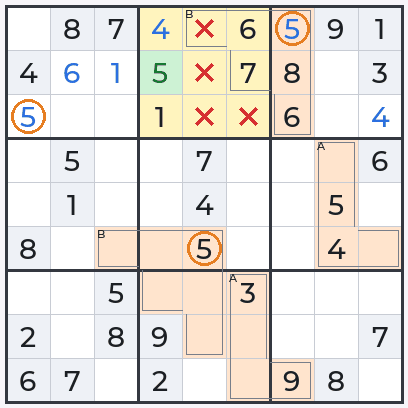

<!-- Written by tools/walkthrough.py clone-sudoku: edit the script, not this page. -->
# Clone Sudoku, step 7: the 5 in box 2

**Step 7 of 50** · [← Step 6](step-06.md) · [All steps](../clone-sudoku.md#the-whole-puzzle-step-by-step) · [Step 8 →](step-08.md)

Box 2 needs a 5. r1c5: row 1 has one (r1c7). r2c5: column 5 has one (r6c5). r3c5 and r3c6: row 3 has one (r3c1). Only **r2c4** is left: **r2c4 = 5**.

**Step 7 of 50** · [← Step 6](step-06.md) · [All steps](../clone-sudoku.md#the-whole-puzzle-step-by-step) · [Step 8 →](step-08.md)
