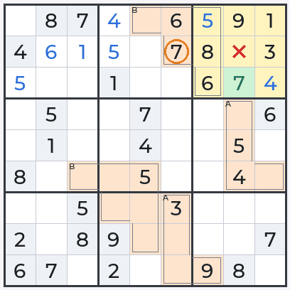

<!-- Written by tools/walkthrough.py clone-sudoku: edit the script, not this page. -->
# Clone Sudoku, step 8: the 7 in box 3

**Step 8 of 50** · [← Step 7](step-07.md) · [All steps](../clone-sudoku.md#the-whole-puzzle-step-by-step) · [Step 9 →](step-09.md)

Box 3 needs a 7. r2c8: row 2 has one (r2c6). Only **r3c8** is left: **r3c8 = 7**.

**Step 8 of 50** · [← Step 7](step-07.md) · [All steps](../clone-sudoku.md#the-whole-puzzle-step-by-step) · [Step 9 →](step-09.md)
