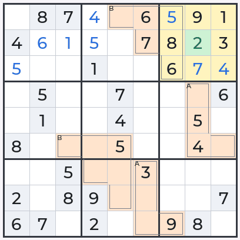

<!-- Written by tools/walkthrough.py clone-sudoku: edit the script, not this page. -->
# Clone Sudoku, step 9: the 2 in box 3

**Step 9 of 50** · [← Step 8](step-08.md) · [All steps](../clone-sudoku.md#the-whole-puzzle-step-by-step) · [Step 10 →](step-10.md)

Box 3 needs a 2, and r2c8 is its last empty cell: **r2c8 = 2**.

**Step 9 of 50** · [← Step 8](step-08.md) · [All steps](../clone-sudoku.md#the-whole-puzzle-step-by-step) · [Step 10 →](step-10.md)
