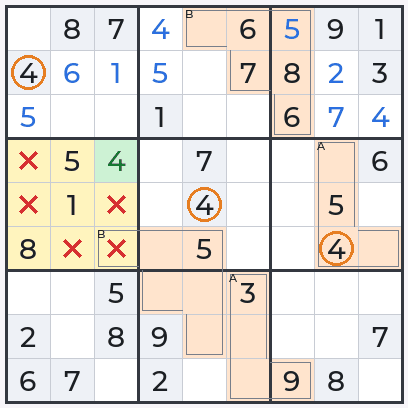

<!-- Written by tools/walkthrough.py clone-sudoku: edit the script, not this page. -->
# Clone Sudoku, step 10: the 4 in box 4

**Step 10 of 50** · [← Step 9](step-09.md) · [All steps](../clone-sudoku.md#the-whole-puzzle-step-by-step) · [Step 11 →](step-11.md)

Box 4 needs a 4. r4c1: column 1 has one (r2c1). r5c1 and r5c3: row 5 has one (r5c5). r6c2 and r6c3: row 6 has one (r6c8). Only **r4c3** is left: **r4c3 = 4**.

**Step 10 of 50** · [← Step 9](step-09.md) · [All steps](../clone-sudoku.md#the-whole-puzzle-step-by-step) · [Step 11 →](step-11.md)
