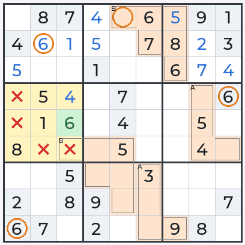

<!-- Written by tools/walkthrough.py clone-sudoku: edit the script, not this page. -->
# Clone Sudoku, step 11: the 6 in box 4

**Step 11 of 50** · [← Step 10](step-10.md) · [All steps](../clone-sudoku.md#the-whole-puzzle-step-by-step) · [Step 12 →](step-12.md)

Box 4 needs a 6. r4c1: row 4 has one (r4c9). r5c1: column 1 has one (r9c1). r6c2: column 2 has one (r2c2). r6c3: its clone, r1c5, can't be 6. Only **r5c3** is left: **r5c3 = 6**.

**Step 11 of 50** · [← Step 10](step-10.md) · [All steps](../clone-sudoku.md#the-whole-puzzle-step-by-step) · [Step 12 →](step-12.md)
