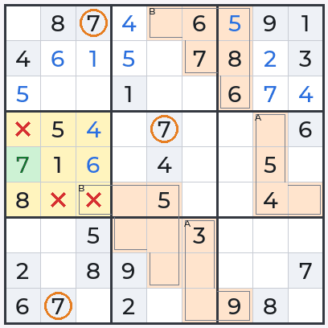

<!-- Written by tools/walkthrough.py clone-sudoku: edit the script, not this page. -->
# Clone Sudoku, step 12: the 7 in box 4

**Step 12 of 50** · [← Step 11](step-11.md) · [All steps](../clone-sudoku.md#the-whole-puzzle-step-by-step) · [Step 13 →](step-13.md)

Box 4 needs a 7. r4c1: row 4 has one (r4c5). r6c2: column 2 has one (r9c2). r6c3: column 3 has one (r1c3). Only **r5c1** is left: **r5c1 = 7**.

**Step 12 of 50** · [← Step 11](step-11.md) · [All steps](../clone-sudoku.md#the-whole-puzzle-step-by-step) · [Step 13 →](step-13.md)
