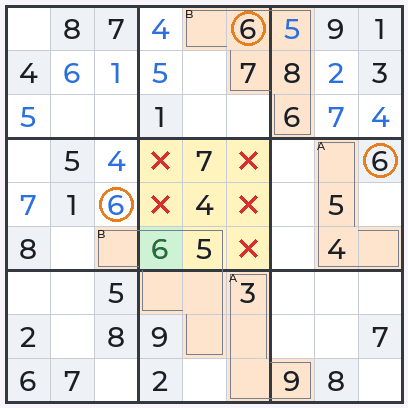

<!-- Written by tools/walkthrough.py clone-sudoku: edit the script, not this page. -->
# Clone Sudoku, step 13: the 6 in box 5

**Step 13 of 50** · [← Step 12](step-12.md) · [All steps](../clone-sudoku.md#the-whole-puzzle-step-by-step) · [Step 14 →](step-14.md)

Box 5 needs a 6. r4c4 and r4c6: row 4 has one (r4c9). r5c4 and r5c6: row 5 has one (r5c3). r6c6: column 6 has one (r1c6). Only **r6c4** is left: **r6c4 = 6**.

**Step 13 of 50** · [← Step 12](step-12.md) · [All steps](../clone-sudoku.md#the-whole-puzzle-step-by-step) · [Step 14 →](step-14.md)
