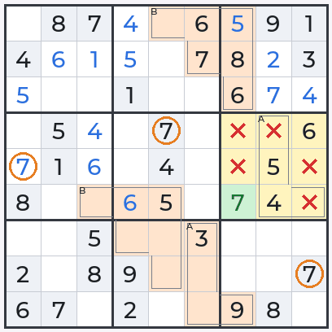

<!-- Written by tools/walkthrough.py clone-sudoku: edit the script, not this page. -->
# Clone Sudoku, step 14: the 7 in box 6

**Step 14 of 50** · [← Step 13](step-13.md) · [All steps](../clone-sudoku.md#the-whole-puzzle-step-by-step) · [Step 15 →](step-15.md)

Box 6 needs a 7. r4c7 and r4c8: row 4 has one (r4c5). r5c7 and r5c9: row 5 has one (r5c1). r6c9: column 9 has one (r8c9). Only **r6c7** is left: **r6c7 = 7**.

**Step 14 of 50** · [← Step 13](step-13.md) · [All steps](../clone-sudoku.md#the-whole-puzzle-step-by-step) · [Step 15 →](step-15.md)
