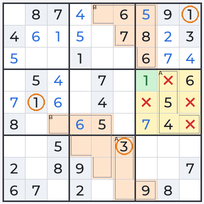

<!-- Written by tools/walkthrough.py clone-sudoku: edit the script, not this page. -->
# Clone Sudoku, step 15: the 1 in box 6

**Step 15 of 50** · [← Step 14](step-14.md) · [All steps](../clone-sudoku.md#the-whole-puzzle-step-by-step) · [Step 16 →](step-16.md)

Box 6 needs a 1. r5c7 and r5c9: row 5 has one (r5c2). r6c9: column 9 has one (r1c9). r4c8: its clone, r7c6, is 3: they hold the same digit. Only **r4c7** is left: **r4c7 = 1**.

**Step 15 of 50** · [← Step 14](step-14.md) · [All steps](../clone-sudoku.md#the-whole-puzzle-step-by-step) · [Step 16 →](step-16.md)
