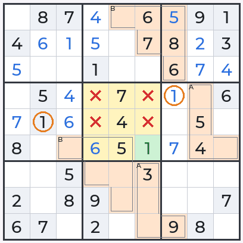

<!-- Written by tools/walkthrough.py clone-sudoku: edit the script, not this page. -->
# Clone Sudoku, step 16: the 1 in box 5

**Step 16 of 50** · [← Step 15](step-15.md) · [All steps](../clone-sudoku.md#the-whole-puzzle-step-by-step) · [Step 17 →](step-17.md)

Box 5 needs a 1. r4c4 and r4c6: row 4 has one (r4c7). r5c4 and r5c6: row 5 has one (r5c2). Only **r6c6** is left: **r6c6 = 1**.

**Step 16 of 50** · [← Step 15](step-15.md) · [All steps](../clone-sudoku.md#the-whole-puzzle-step-by-step) · [Step 17 →](step-17.md)
