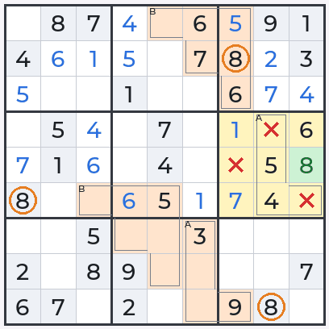

<!-- Written by tools/walkthrough.py clone-sudoku: edit the script, not this page. -->
# Clone Sudoku, step 17: the 8 in box 6

**Step 17 of 50** · [← Step 16](step-16.md) · [All steps](../clone-sudoku.md#the-whole-puzzle-step-by-step) · [Step 18 →](step-18.md)

Box 6 needs an 8. r4c8: column 8 has one (r9c8). r5c7: column 7 has one (r2c7). r6c9: row 6 has one (r6c1). Only **r5c9** is left: **r5c9 = 8**.

**Step 17 of 50** · [← Step 16](step-16.md) · [All steps](../clone-sudoku.md#the-whole-puzzle-step-by-step) · [Step 18 →](step-18.md)
