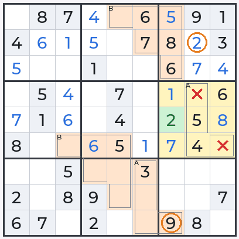

<!-- Written by tools/walkthrough.py clone-sudoku: edit the script, not this page. -->
# Clone Sudoku, step 18: the 2 in box 6

**Step 18 of 50** · [← Step 17](step-17.md) · [All steps](../clone-sudoku.md#the-whole-puzzle-step-by-step) · [Step 19 →](step-19.md)

Box 6 needs a 2. r4c8: column 8 has one (r2c8). r6c9: its clone, r9c7, is 9: they hold the same digit. Only **r5c7** is left: **r5c7 = 2**.

**Step 18 of 50** · [← Step 17](step-17.md) · [All steps](../clone-sudoku.md#the-whole-puzzle-step-by-step) · [Step 19 →](step-19.md)
