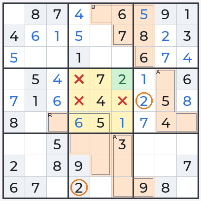

<!-- Written by tools/walkthrough.py clone-sudoku: edit the script, not this page. -->
# Clone Sudoku, step 19: the 2 in box 5

**Step 19 of 50** · [← Step 18](step-18.md) · [All steps](../clone-sudoku.md#the-whole-puzzle-step-by-step) · [Step 20 →](step-20.md)

Box 5 needs a 2. r4c4: column 4 has one (r9c4). r5c4 and r5c6: row 5 has one (r5c7). Only **r4c6** is left: **r4c6 = 2**.

**Step 19 of 50** · [← Step 18](step-18.md) · [All steps](../clone-sudoku.md#the-whole-puzzle-step-by-step) · [Step 20 →](step-20.md)
