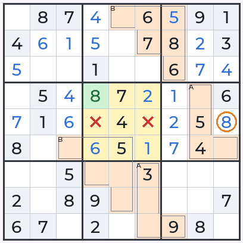

<!-- Written by tools/walkthrough.py clone-sudoku: edit the script, not this page. -->
# Clone Sudoku, step 20: the 8 in box 5

**Step 20 of 50** · [← Step 19](step-19.md) · [All steps](../clone-sudoku.md#the-whole-puzzle-step-by-step) · [Step 21 →](step-21.md)

Box 5 needs an 8. r5c4 and r5c6: row 5 has one (r5c9). Only **r4c4** is left: **r4c4 = 8**.

**Step 20 of 50** · [← Step 19](step-19.md) · [All steps](../clone-sudoku.md#the-whole-puzzle-step-by-step) · [Step 21 →](step-21.md)
