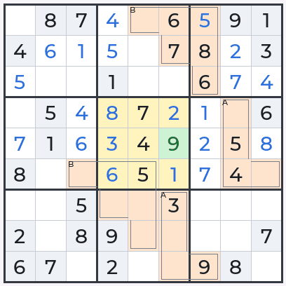

<!-- Written by tools/walkthrough.py clone-sudoku: edit the script, not this page. -->
# Clone Sudoku, step 22: the 9 in box 5

**Step 22 of 50** · [← Step 21](step-21.md) · [All steps](../clone-sudoku.md#the-whole-puzzle-step-by-step) · [Step 23 →](step-23.md)

Box 5 needs a 9, and r5c6 is its last empty cell: **r5c6 = 9**.

**Step 22 of 50** · [← Step 21](step-21.md) · [All steps](../clone-sudoku.md#the-whole-puzzle-step-by-step) · [Step 23 →](step-23.md)
