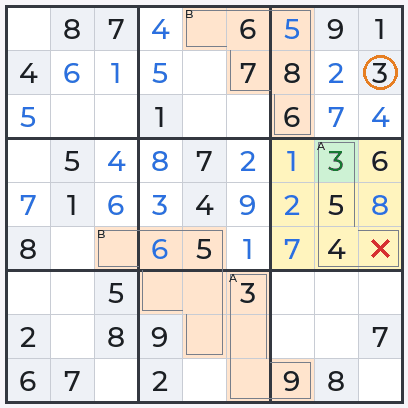

<!-- Written by tools/walkthrough.py clone-sudoku: edit the script, not this page. -->
# Clone Sudoku, step 23: the 3 in box 6

**Step 23 of 50** · [← Step 22](step-22.md) · [All steps](../clone-sudoku.md#the-whole-puzzle-step-by-step) · [Step 24 →](step-24.md)

Box 6 needs a 3. r6c9: column 9 has one (r2c9). Only **r4c8** is left: **r4c8 = 3**.

**Step 23 of 50** · [← Step 22](step-22.md) · [All steps](../clone-sudoku.md#the-whole-puzzle-step-by-step) · [Step 24 →](step-24.md)
