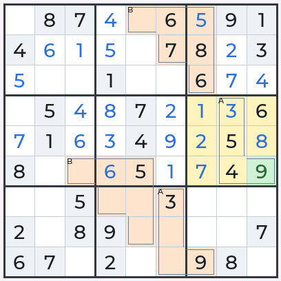

<!-- Written by tools/walkthrough.py clone-sudoku: edit the script, not this page. -->
# Clone Sudoku, step 24: the 9 in box 6

**Step 24 of 50** · [← Step 23](step-23.md) · [All steps](../clone-sudoku.md#the-whole-puzzle-step-by-step) · [Step 25 →](step-25.md)

Box 6 needs a 9, and r6c9 is its last empty cell: **r6c9 = 9**.

**Step 24 of 50** · [← Step 23](step-23.md) · [All steps](../clone-sudoku.md#the-whole-puzzle-step-by-step) · [Step 25 →](step-25.md)
