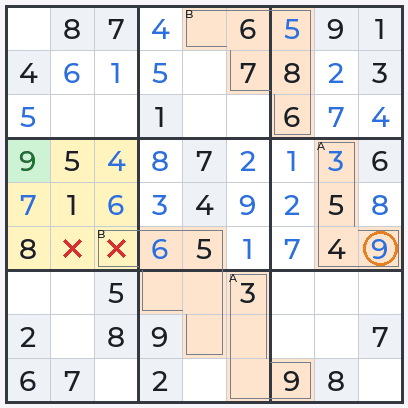

<!-- Written by tools/walkthrough.py clone-sudoku: edit the script, not this page. -->
# Clone Sudoku, step 25: the 9 in box 4

**Step 25 of 50** · [← Step 24](step-24.md) · [All steps](../clone-sudoku.md#the-whole-puzzle-step-by-step) · [Step 26 →](step-26.md)

Box 4 needs a 9. r6c2 and r6c3: row 6 has one (r6c9). Only **r4c1** is left: **r4c1 = 9**.

**Step 25 of 50** · [← Step 24](step-24.md) · [All steps](../clone-sudoku.md#the-whole-puzzle-step-by-step) · [Step 26 →](step-26.md)
