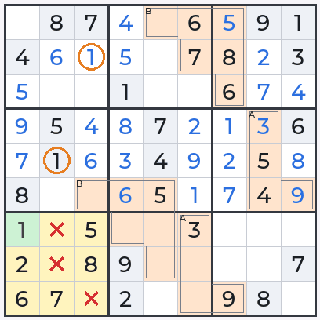

<!-- Written by tools/walkthrough.py clone-sudoku: edit the script, not this page. -->
# Clone Sudoku, step 26: the 1 in box 7

**Step 26 of 50** · [← Step 25](step-25.md) · [All steps](../clone-sudoku.md#the-whole-puzzle-step-by-step) · [Step 27 →](step-27.md)

Box 7 needs a 1. r7c2 and r8c2: column 2 has one (r5c2). r9c3: column 3 has one (r2c3). Only **r7c1** is left: **r7c1 = 1**.

**Step 26 of 50** · [← Step 25](step-25.md) · [All steps](../clone-sudoku.md#the-whole-puzzle-step-by-step) · [Step 27 →](step-27.md)
