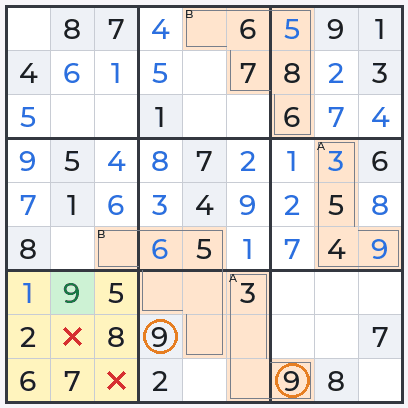

<!-- Written by tools/walkthrough.py clone-sudoku: edit the script, not this page. -->
# Clone Sudoku, step 27: the 9 in box 7

**Step 27 of 50** · [← Step 26](step-26.md) · [All steps](../clone-sudoku.md#the-whole-puzzle-step-by-step) · [Step 28 →](step-28.md)

Box 7 needs a 9. r8c2: row 8 has one (r8c4). r9c3: row 9 has one (r9c7). Only **r7c2** is left: **r7c2 = 9**.

**Step 27 of 50** · [← Step 26](step-26.md) · [All steps](../clone-sudoku.md#the-whole-puzzle-step-by-step) · [Step 28 →](step-28.md)
