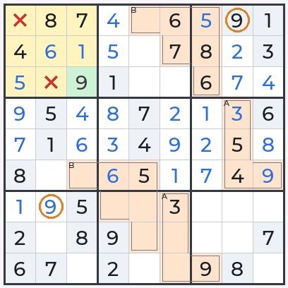

<!-- Written by tools/walkthrough.py clone-sudoku: edit the script, not this page. -->
# Clone Sudoku, step 28: the 9 in box 1

**Step 28 of 50** · [← Step 27](step-27.md) · [All steps](../clone-sudoku.md#the-whole-puzzle-step-by-step) · [Step 29 →](step-29.md)

Box 1 needs a 9. r1c1: row 1 has one (r1c8). r3c2: column 2 has one (r7c2). Only **r3c3** is left: **r3c3 = 9**.

**Step 28 of 50** · [← Step 27](step-27.md) · [All steps](../clone-sudoku.md#the-whole-puzzle-step-by-step) · [Step 29 →](step-29.md)
