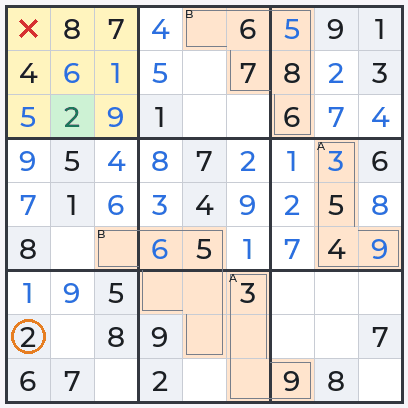

<!-- Written by tools/walkthrough.py clone-sudoku: edit the script, not this page. -->
# Clone Sudoku, step 29: the 2 in box 1

**Step 29 of 50** · [← Step 28](step-28.md) · [All steps](../clone-sudoku.md#the-whole-puzzle-step-by-step) · [Step 30 →](step-30.md)

Box 1 needs a 2. r1c1: column 1 has one (r8c1). Only **r3c2** is left: **r3c2 = 2**.

**Step 29 of 50** · [← Step 28](step-28.md) · [All steps](../clone-sudoku.md#the-whole-puzzle-step-by-step) · [Step 30 →](step-30.md)
