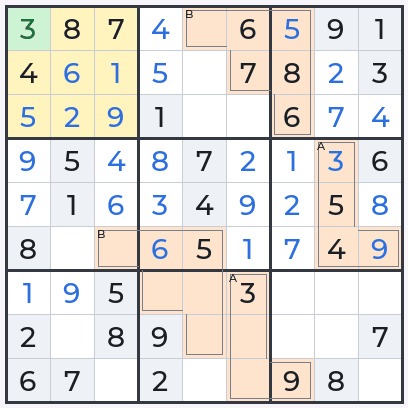

<!-- Written by tools/walkthrough.py clone-sudoku: edit the script, not this page. -->
# Clone Sudoku, step 30: the 3 in box 1

**Step 30 of 50** · [← Step 29](step-29.md) · [All steps](../clone-sudoku.md#the-whole-puzzle-step-by-step) · [Step 31 →](step-31.md)

Box 1 needs a 3, and r1c1 is its last empty cell: **r1c1 = 3**.

**Step 30 of 50** · [← Step 29](step-29.md) · [All steps](../clone-sudoku.md#the-whole-puzzle-step-by-step) · [Step 31 →](step-31.md)
