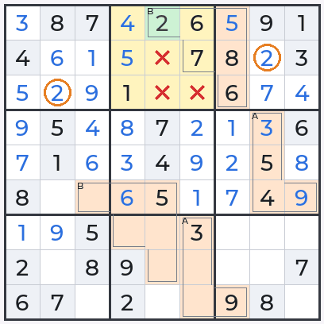

<!-- Written by tools/walkthrough.py clone-sudoku: edit the script, not this page. -->
# Clone Sudoku, step 31: the 2 in box 2

**Step 31 of 50** · [← Step 30](step-30.md) · [All steps](../clone-sudoku.md#the-whole-puzzle-step-by-step) · [Step 32 →](step-32.md)

Box 2 needs a 2. r2c5: row 2 has one (r2c8). r3c5 and r3c6: row 3 has one (r3c2). Only **r1c5** is left: **r1c5 = 2**.

**Step 31 of 50** · [← Step 30](step-30.md) · [All steps](../clone-sudoku.md#the-whole-puzzle-step-by-step) · [Step 32 →](step-32.md)
