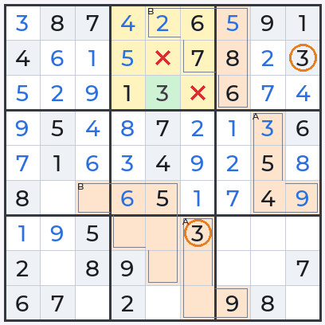

<!-- Written by tools/walkthrough.py clone-sudoku: edit the script, not this page. -->
# Clone Sudoku, step 32: the 3 in box 2

**Step 32 of 50** · [← Step 31](step-31.md) · [All steps](../clone-sudoku.md#the-whole-puzzle-step-by-step) · [Step 33 →](step-33.md)

Box 2 needs a 3. r2c5: row 2 has one (r2c9). r3c6: column 6 has one (r7c6). Only **r3c5** is left: **r3c5 = 3**.

**Step 32 of 50** · [← Step 31](step-31.md) · [All steps](../clone-sudoku.md#the-whole-puzzle-step-by-step) · [Step 33 →](step-33.md)
