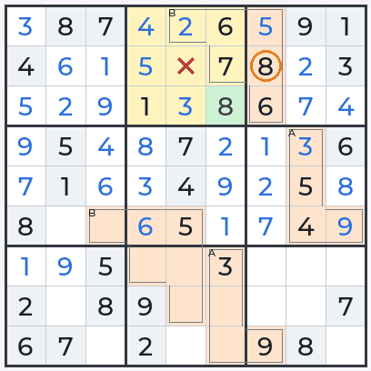

<!-- Written by tools/walkthrough.py clone-sudoku: edit the script, not this page. -->
# Clone Sudoku, step 33: the 8 in box 2

**Step 33 of 50** · [← Step 32](step-32.md) · [All steps](../clone-sudoku.md#the-whole-puzzle-step-by-step) · [Step 34 →](step-34.md)

Box 2 needs an 8. r2c5: row 2 has one (r2c7). Only **r3c6** is left: **r3c6 = 8**.

**Step 33 of 50** · [← Step 32](step-32.md) · [All steps](../clone-sudoku.md#the-whole-puzzle-step-by-step) · [Step 34 →](step-34.md)
