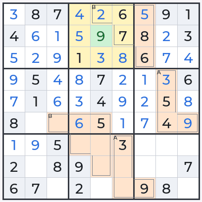

<!-- Written by tools/walkthrough.py clone-sudoku: edit the script, not this page. -->
# Clone Sudoku, step 34: the 9 in box 2

**Step 34 of 50** · [← Step 33](step-33.md) · [All steps](../clone-sudoku.md#the-whole-puzzle-step-by-step) · [Step 35 →](step-35.md)

Box 2 needs a 9, and r2c5 is its last empty cell: **r2c5 = 9**.

**Step 34 of 50** · [← Step 33](step-33.md) · [All steps](../clone-sudoku.md#the-whole-puzzle-step-by-step) · [Step 35 →](step-35.md)
