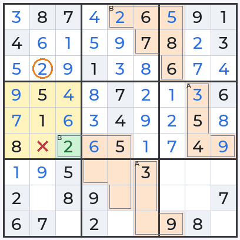

<!-- Written by tools/walkthrough.py clone-sudoku: edit the script, not this page. -->
# Clone Sudoku, step 35: the 2 in box 4

**Step 35 of 50** · [← Step 34](step-34.md) · [All steps](../clone-sudoku.md#the-whole-puzzle-step-by-step) · [Step 36 →](step-36.md)

Box 4 needs a 2. r6c2: column 2 has one (r3c2). Only **r6c3** is left: **r6c3 = 2**.

**Step 35 of 50** · [← Step 34](step-34.md) · [All steps](../clone-sudoku.md#the-whole-puzzle-step-by-step) · [Step 36 →](step-36.md)
