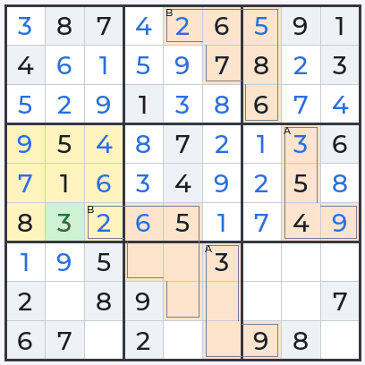

<!-- Written by tools/walkthrough.py clone-sudoku: edit the script, not this page. -->
# Clone Sudoku, step 36: the 3 in box 4

**Step 36 of 50** · [← Step 35](step-35.md) · [All steps](../clone-sudoku.md#the-whole-puzzle-step-by-step) · [Step 37 →](step-37.md)

Box 4 needs a 3, and r6c2 is its last empty cell: **r6c2 = 3**.

**Step 36 of 50** · [← Step 35](step-35.md) · [All steps](../clone-sudoku.md#the-whole-puzzle-step-by-step) · [Step 37 →](step-37.md)
