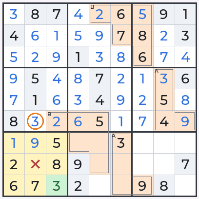

<!-- Written by tools/walkthrough.py clone-sudoku: edit the script, not this page. -->
# Clone Sudoku, step 37: the 3 in box 7

**Step 37 of 50** · [← Step 36](step-36.md) · [All steps](../clone-sudoku.md#the-whole-puzzle-step-by-step) · [Step 38 →](step-38.md)

Box 7 needs a 3. r8c2: column 2 has one (r6c2). Only **r9c3** is left: **r9c3 = 3**.

**Step 37 of 50** · [← Step 36](step-36.md) · [All steps](../clone-sudoku.md#the-whole-puzzle-step-by-step) · [Step 38 →](step-38.md)
