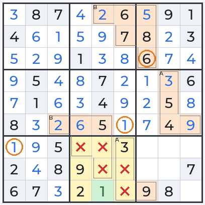

<!-- Written by tools/walkthrough.py clone-sudoku: edit the script, not this page. -->
# Clone Sudoku, step 39: the 1 in box 8

**Step 39 of 50** · [← Step 38](step-38.md) · [All steps](../clone-sudoku.md#the-whole-puzzle-step-by-step) · [Step 40 →](step-40.md)

Box 8 needs a 1. r7c4 and r7c5: row 7 has one (r7c1). r8c6 and r9c6: column 6 has one (r6c6). r8c5: its clone, r3c7, is 6: they hold the same digit. Only **r9c5** is left: **r9c5 = 1**.

**Step 39 of 50** · [← Step 38](step-38.md) · [All steps](../clone-sudoku.md#the-whole-puzzle-step-by-step) · [Step 40 →](step-40.md)
