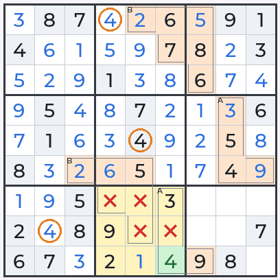

<!-- Written by tools/walkthrough.py clone-sudoku: edit the script, not this page. -->
# Clone Sudoku, step 40: the 4 in box 8

**Step 40 of 50** · [← Step 39](step-39.md) · [All steps](../clone-sudoku.md#the-whole-puzzle-step-by-step) · [Step 41 →](step-41.md)

Box 8 needs a 4. r7c4: column 4 has one (r1c4). r7c5: column 5 has one (r5c5). r8c5 and r8c6: row 8 has one (r8c2). Only **r9c6** is left: **r9c6 = 4**.

**Step 40 of 50** · [← Step 39](step-39.md) · [All steps](../clone-sudoku.md#the-whole-puzzle-step-by-step) · [Step 41 →](step-41.md)
