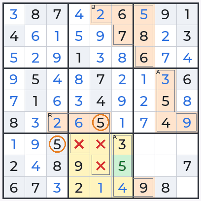

<!-- Written by tools/walkthrough.py clone-sudoku: edit the script, not this page. -->
# Clone Sudoku, step 41: the 5 in box 8

**Step 41 of 50** · [← Step 40](step-40.md) · [All steps](../clone-sudoku.md#the-whole-puzzle-step-by-step) · [Step 42 →](step-42.md)

Box 8 needs a 5. r7c4 and r7c5: row 7 has one (r7c3). r8c5: column 5 has one (r6c5). Only **r8c6** is left: **r8c6 = 5**.

**Step 41 of 50** · [← Step 40](step-40.md) · [All steps](../clone-sudoku.md#the-whole-puzzle-step-by-step) · [Step 42 →](step-42.md)
