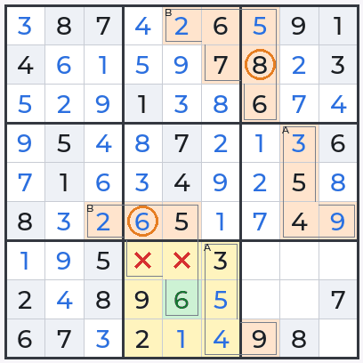

<!-- Written by tools/walkthrough.py clone-sudoku: edit the script, not this page. -->
# Clone Sudoku, step 42: the 6 in box 8

**Step 42 of 50** · [← Step 41](step-41.md) · [All steps](../clone-sudoku.md#the-whole-puzzle-step-by-step) · [Step 43 →](step-43.md)

Box 8 needs a 6. r7c4: column 4 has one (r6c4). r7c5: its clone, r2c7, is 8: they hold the same digit. Only **r8c5** is left: **r8c5 = 6**.

**Step 42 of 50** · [← Step 41](step-41.md) · [All steps](../clone-sudoku.md#the-whole-puzzle-step-by-step) · [Step 43 →](step-43.md)
