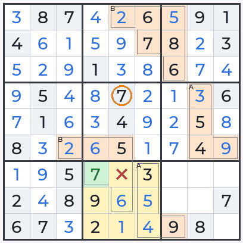

<!-- Written by tools/walkthrough.py clone-sudoku: edit the script, not this page. -->
# Clone Sudoku, step 43: the 7 in box 8

**Step 43 of 50** · [← Step 42](step-42.md) · [All steps](../clone-sudoku.md#the-whole-puzzle-step-by-step) · [Step 44 →](step-44.md)

Box 8 needs a 7. r7c5: column 5 has one (r4c5). Only **r7c4** is left: **r7c4 = 7**.

**Step 43 of 50** · [← Step 42](step-42.md) · [All steps](../clone-sudoku.md#the-whole-puzzle-step-by-step) · [Step 44 →](step-44.md)
