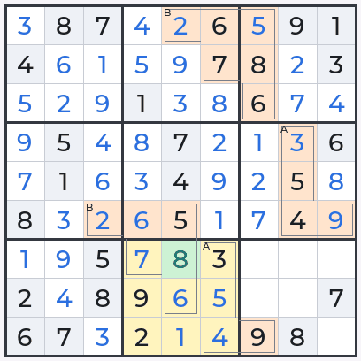

<!-- Written by tools/walkthrough.py clone-sudoku: edit the script, not this page. -->
# Clone Sudoku, step 44: the 8 in box 8

**Step 44 of 50** · [← Step 43](step-43.md) · [All steps](../clone-sudoku.md#the-whole-puzzle-step-by-step) · [Step 45 →](step-45.md)

Box 8 needs an 8, and r7c5 is its last empty cell: **r7c5 = 8**.

**Step 44 of 50** · [← Step 43](step-43.md) · [All steps](../clone-sudoku.md#the-whole-puzzle-step-by-step) · [Step 45 →](step-45.md)
