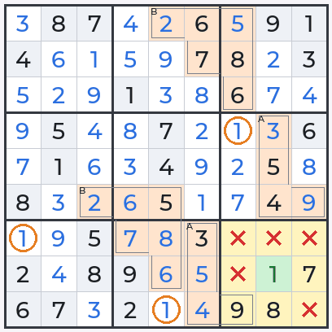

<!-- Written by tools/walkthrough.py clone-sudoku: edit the script, not this page. -->
# Clone Sudoku, step 45: the 1 in box 9

**Step 45 of 50** · [← Step 44](step-44.md) · [All steps](../clone-sudoku.md#the-whole-puzzle-step-by-step) · [Step 46 →](step-46.md)

Box 9 needs a 1. r7c7, r7c8 and r7c9: row 7 has one (r7c1). r8c7: column 7 has one (r4c7). r9c9: row 9 has one (r9c5). Only **r8c8** is left: **r8c8 = 1**.

**Step 45 of 50** · [← Step 44](step-44.md) · [All steps](../clone-sudoku.md#the-whole-puzzle-step-by-step) · [Step 46 →](step-46.md)
