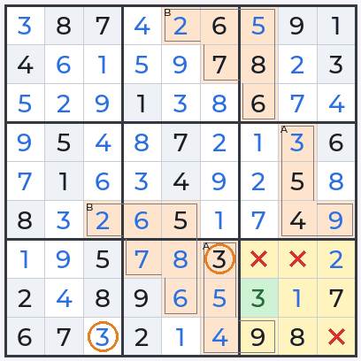

<!-- Written by tools/walkthrough.py clone-sudoku: edit the script, not this page. -->
# Clone Sudoku, step 47: the 3 in box 9

**Step 47 of 50** · [← Step 46](step-46.md) · [All steps](../clone-sudoku.md#the-whole-puzzle-step-by-step) · [Step 48 →](step-48.md)

Box 9 needs a 3. r7c7 and r7c8: row 7 has one (r7c6). r9c9: row 9 has one (r9c3). Only **r8c7** is left: **r8c7 = 3**.

**Step 47 of 50** · [← Step 46](step-46.md) · [All steps](../clone-sudoku.md#the-whole-puzzle-step-by-step) · [Step 48 →](step-48.md)
