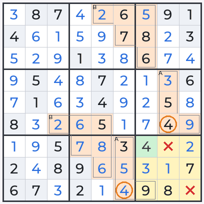

<!-- Written by tools/walkthrough.py clone-sudoku: edit the script, not this page. -->
# Clone Sudoku, step 48: the 4 in box 9

**Step 48 of 50** · [← Step 47](step-47.md) · [All steps](../clone-sudoku.md#the-whole-puzzle-step-by-step) · [Step 49 →](step-49.md)

Box 9 needs a 4. r7c8: column 8 has one (r6c8). r9c9: row 9 has one (r9c6). Only **r7c7** is left: **r7c7 = 4**.

**Step 48 of 50** · [← Step 47](step-47.md) · [All steps](../clone-sudoku.md#the-whole-puzzle-step-by-step) · [Step 49 →](step-49.md)
