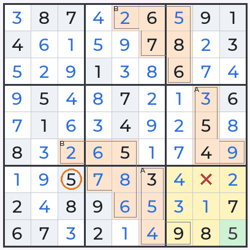

<!-- Written by tools/walkthrough.py clone-sudoku: edit the script, not this page. -->
# Clone Sudoku, step 49: the 5 in box 9

**Step 49 of 50** · [← Step 48](step-48.md) · [All steps](../clone-sudoku.md#the-whole-puzzle-step-by-step) · [Step 50 →](step-50.md)

Box 9 needs a 5. r7c8: row 7 has one (r7c3). Only **r9c9** is left: **r9c9 = 5**.

**Step 49 of 50** · [← Step 48](step-48.md) · [All steps](../clone-sudoku.md#the-whole-puzzle-step-by-step) · [Step 50 →](step-50.md)
