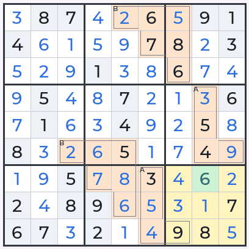

<!-- Written by tools/walkthrough.py clone-sudoku: edit the script, not this page. -->
# Clone Sudoku, step 50: the 6 in box 9

**Step 50 of 50** · [← Step 49](step-49.md) · [All steps](../clone-sudoku.md#the-whole-puzzle-step-by-step) · [All steps](../clone-sudoku.md#the-whole-puzzle-step-by-step)

Box 9 needs a 6, and r7c8 is its last empty cell: **r7c8 = 6**.

Solved.

**Step 50 of 50** · [← Step 49](step-49.md) · [All steps](../clone-sudoku.md#the-whole-puzzle-step-by-step) · [All steps](../clone-sudoku.md#the-whole-puzzle-step-by-step)
