# Consecutive

[← All variants](README.md) · [Puzzles](../features-puzzles.md) · [How to play](../how-to-play.md)


## The rules

[Classic](classic.md) rules, and an orange **bar** sits on the line between every two side-by-side cells whose digits are **1 apart** (like 4 and 5). Every such pair has a bar, so **where there's no bar, the two digits are not 1 apart**. Cells that only touch at a corner don't count.

## On the board

- The bars are short orange marks across the line between two cells.
- Two digits that break the rule (a bar and not 1 apart, or 1 apart with no bar) turn red.
- The grader and hints use the bars: "The bars around row 4, column 2 (and where there are none) leave it only 3, 5".
- **Puzzles → ⋮ → New puzzle → Consecutive**. The bars carry most of the puzzle: Easy keeps about 14 givens, Expert as few as 2 to 4.

## How to solve it

- **A bar next to a digit** leaves two choices: next to a 6, the cell is 5 or 7. Next to a 1 or a 9, only one: 2 or 8.
- **No bar is information too.** A cell next to a 5 with no bar can't be 4 or 6. A cell with no bars at all around it, next to several filled cells, loses a lot of candidates.
- **Count the bars:** a 1 can only have a bar to a 2, and a row and a column each hold one 2, so a 1 (or a 9) has at most two bars. A cell with three or four bars is 2 to 8.
- In the worked example, both kinds show up: bars that leave two choices, and missing bars that rule a digit out.

## Worked example

**variant-examples #9**, Consecutive Easy (see [Classic](classic.md#worked-example) for how to import the examples; cells are written r*row*c*column*). The bars are in the screenshot.

```
. . . | . . . | . . .
. . . | . . . | . . 2
. . . | . . . | . . 5
------+-------+------
. 6 . | 4 9 . | . . .
. . . | 3 . 7 | . . .
. . . | . 8 5 | . 6 .
------+-------+------
5 . . | . . . | . . .
7 . . | . . . | . . .
. . . | . . . | . . .
```

**Step 1: r6c4, with no bar above it.** Row 6 has 8, 5 and 6; column 4 has 4 and 3; box 5 has 4, 9, 3, 7, 8 and 5. By the Classic rules r6c4 could be 1 or 2. But r5c4, right above it, is a 3, and there's **no bar** between them: so r6c4 isn't 2 (or 4). **r6c4 = 1**.

**Step 2: r6c9, with a bar to its left.** There's a **bar** between r6c8 (a 6) and r6c9, so r6c9 is 5 or 7. Row 6 already has a 5 (r6c6). **r6c9 = 7**.

**Step 3: the 5 in box 4.** Box 4 (rows 4–6, columns 1–3) needs a 5:

- r4c1, r5c1: column 1 has a 5 (r7c1).
- r6c1, r6c2, r6c3: row 6 has a 5 (r6c6).
- r4c3: its right-hand neighbour r4c4 is a 4, with **no bar**: r4c3 can't be 3 or 5.
- r5c2: the cell above it, r4c2, is a 6, with **no bar**: r5c2 can't be 5 or 7.

Only **r5c3** is left: **r5c3 = 5**.

While you're at r4c3: it has a **bar** to the 6 on its left (so it's 5 or 7) and no bar to the 4 on its right (so it's not 5): **r4c3 = 7**.

## The whole puzzle, step by step

<!-- walkthrough -->
<!-- Written by tools/walkthrough.py consecutive: edit the script, not this part. -->

The whole puzzle, from the start to the last cell: 69 steps, each one a single (one place left for a digit, or one digit left for a cell), taken in the order a box's single comes first, so not quite the order of the worked example above. In each picture, the unit the step looks at is tinted yellow (for a cell with one digit left: its row, column and box), the new digit is on green, the digits that rule cells out have an **orange ring**, and the empty cells they rule out a **red cross**. Givens are on grey, digits from earlier steps in blue.


#### Step 1: the 5 in box 4

Box 4 needs a 5. r4c1 and r5c1: column 1 has one (r7c1). r6c1, r6c2 and r6c3: row 6 has one (r6c6). r4c3: it has no bar to the 4 in r4c4, so it isn't 3 or 5. r5c2: it has no bar to the 6 in r4c2, so it isn't 5 or 7. Only **r5c3** is left: **r5c3 = 5**.

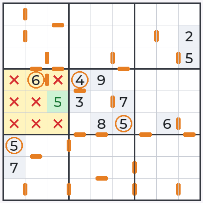

#### Step 2: the 2 in box 5

Box 5 needs a 2. r5c5 and r6c4: it has no bar to the 3 in r5c4, so it isn't 2 or 4. Only **r4c6** is left: **r4c6 = 2**.

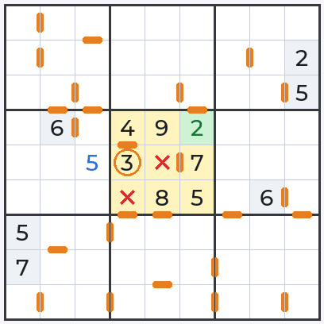

#### Step 3: the 1 in box 5

Box 5 needs a 1. r5c5: it has a bar to the 7 in r5c6, so it's 6 or 8. Only **r6c4** is left: **r6c4 = 1**.

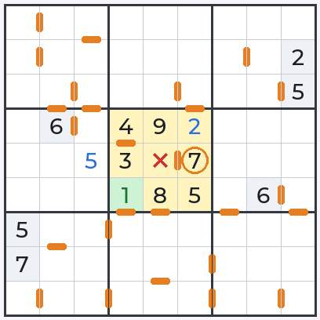

#### Step 4: the 6 in box 5

Box 5 needs a 6, and r5c5 is its last empty cell: **r5c5 = 6**.

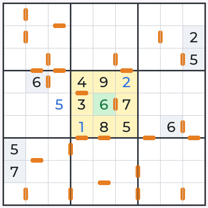

#### Step 5: the 4 in row 6

Row 6 needs a 4. r6c1: it has no bar to the 5 in r7c1, so it isn't 4 or 6. r6c3: it has no bar to the 5 in r5c3, so it isn't 4 or 6. r6c7: it has no bar to the 5 in r6c6, so it isn't 4 or 6. r6c9: it has a bar to the 6 in r6c8, so it's 5 or 7. Only **r6c2** is left: **r6c2 = 4**.

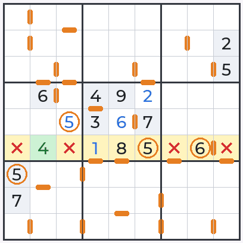

#### Step 6: the 3 in box 4

Box 4 needs a 3. r5c1 and r5c2: row 5 has one (r5c4). r4c3: it has a bar to the 6 in r4c2, so it's 5 or 7. r6c1 and r6c3: it has no bar to the 4 in r6c2, so it isn't 3 or 5. Only **r4c1** is left: **r4c1 = 3**.

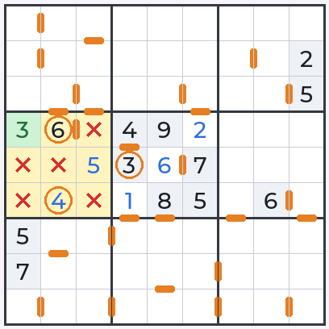

#### Step 7: the 3 in box 6

Box 6 needs a 3. r4c7, r4c8 and r4c9: row 4 has one (r4c1). r5c7, r5c8 and r5c9: row 5 has one (r5c4). r6c9: it has a bar to the 6 in r6c8, so it's 5 or 7. Only **r6c7** is left: **r6c7 = 3**.

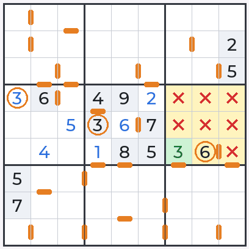

#### Step 8: the 3 in box 3

Box 3 needs a 3. r1c7, r2c7 and r3c7: column 7 has one (r6c7). r1c9 and r2c8: it has no bar to the 2 in r2c9, so it isn't 1 or 3. r3c8: it has a bar to the 5 in r3c9, so it's 4 or 6. Only **r1c8** is left: **r1c8 = 3**.

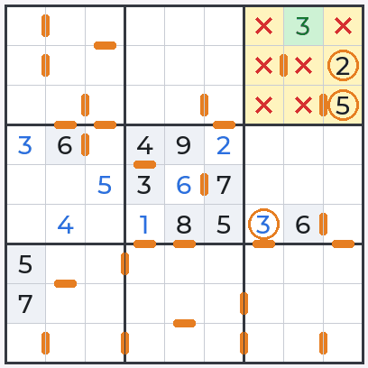

#### Step 9: the 2 in box 6

Box 6 needs a 2. r4c7, r4c8 and r4c9: row 4 has one (r4c6). r5c9 and r6c9: column 9 has one (r2c9). r5c7: it has no bar to the 3 in r6c7, so it isn't 2 or 4. Only **r5c8** is left: **r5c8 = 2**.

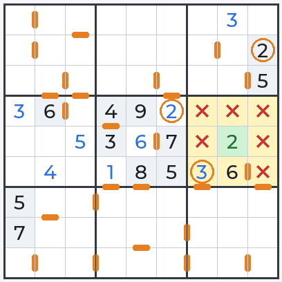

#### Step 10: the 2 in box 4

Box 4 needs a 2. r4c3: row 4 has one (r4c6). r5c1 and r5c2: row 5 has one (r5c8). r6c3: it has no bar to the 1 in r6c4, so it isn't 2. Only **r6c1** is left: **r6c1 = 2**.

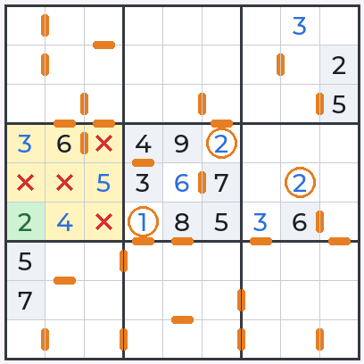

#### Step 11: the 1 in box 4

Box 4 needs a 1. r6c3: row 6 has one (r6c4). r4c3: it has a bar to the 6 in r4c2, so it's 5 or 7. r5c1: it has no bar to the 2 in r6c1, so it isn't 1 or 3. Only **r5c2** is left: **r5c2 = 1**.

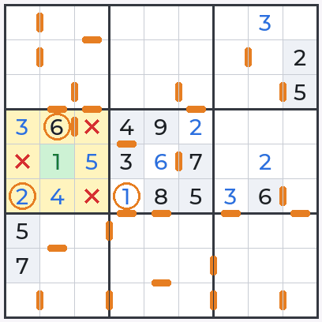

#### Step 12: the 8 in box 4

Box 4 needs an 8. r6c3: row 6 has one (r6c5). r4c3: it has a bar to the 6 in r4c2, so it's 5 or 7. Only **r5c1** is left: **r5c1 = 8**.

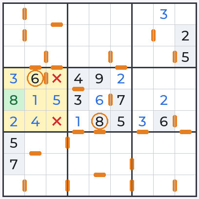

#### Step 13: the 9 in box 4

Box 4 needs a 9. r4c3: row 4 has one (r4c5). Only **r6c3** is left: **r6c3 = 9**.

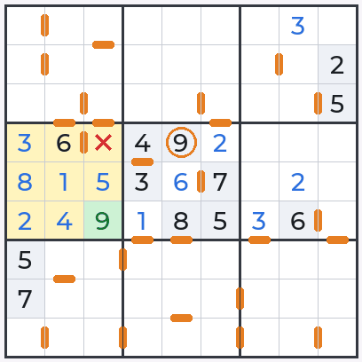

#### Step 14: the 7 in box 4

Box 4 needs a 7, and r4c3 is its last empty cell: **r4c3 = 7**.

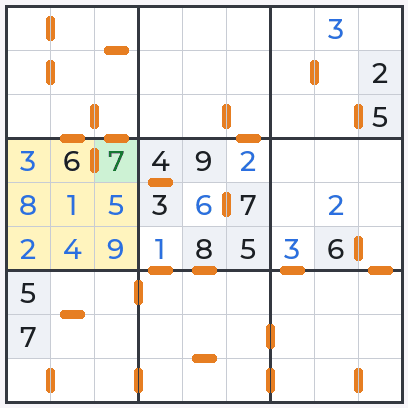

#### Step 15: the 1 in box 6

Box 6 needs a 1. r5c7 and r5c9: row 5 has one (r5c2). r6c9: row 6 has one (r6c4). r4c7: it has no bar to the 2 in r4c6, so it isn't 1 or 3. r4c8: it has no bar to the 2 in r5c8, so it isn't 1 or 3. Only **r4c9** is left: **r4c9 = 1**.

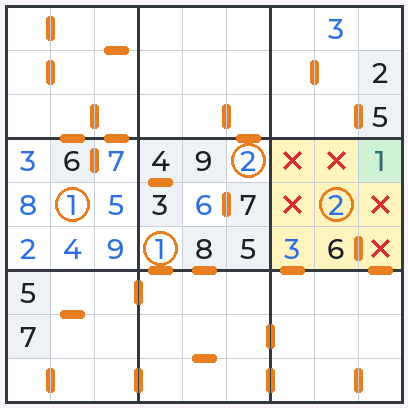

#### Step 16: the 4 in box 6

Box 6 needs a 4. r4c7 and r4c8: row 4 has one (r4c4). r6c9: row 6 has one (r6c2). r5c7: it has no bar to the 3 in r6c7, so it isn't 2 or 4. Only **r5c9** is left: **r5c9 = 4**.

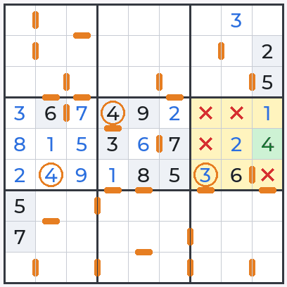

#### Step 17: the 7 in box 6

Box 6 needs a 7. r4c7 and r4c8: row 4 has one (r4c3). r5c7: row 5 has one (r5c6). Only **r6c9** is left: **r6c9 = 7**.

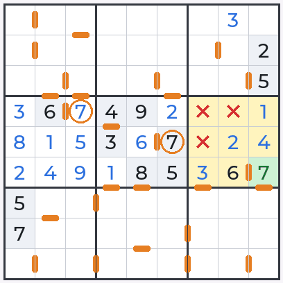

#### Step 18: the 9 in box 6

Box 6 needs a 9. r4c7 and r4c8: row 4 has one (r4c5). Only **r5c7** is left: **r5c7 = 9**.

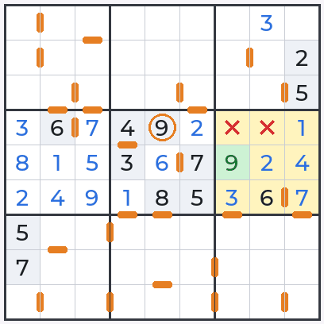

#### Step 19: the 8 in box 6

Box 6 needs an 8. r4c7: it has no bar to the 9 in r5c7, so it isn't 8. Only **r4c8** is left: **r4c8 = 8**.

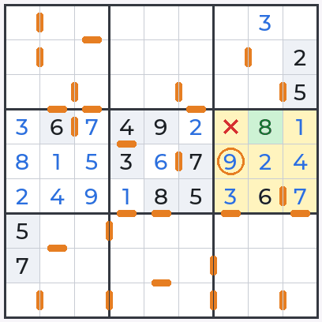

#### Step 20: the 5 in box 6

Box 6 needs a 5, and r4c7 is its last empty cell: **r4c7 = 5**.

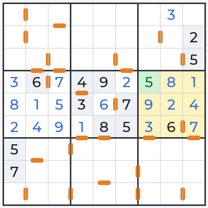

#### Step 21: the 7 in row 7

Row 7 needs a 7. r7c2: box 7 has one (r8c1). r7c3: column 3 has one (r4c3). r7c6: column 6 has one (r5c6). r7c9: column 9 has one (r6c9). r7c4: it has a bar to the 1 in r6c4, so it's 2. r7c7: it has a bar to the 3 in r6c7, so it's 2 or 4. r7c8: it has no bar to the 6 in r6c8, so it isn't 5 or 7. Only **r7c5** is left: **r7c5 = 7**.

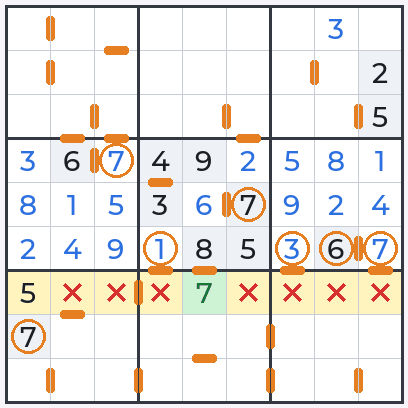

#### Step 22: r3c2

Column 2 has 1, 4 and 6; row 3 has 5. Not 2, 3, 8 or 9: it has a bar to the 6 in r4c2, so it's 5 or 7. Only 7 is left: **r3c2 = 7**.

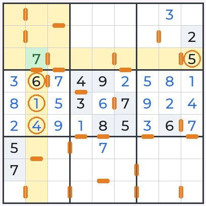

#### Step 23: r3c8

Column 8 has 2, 3, 6 and 8; row 3 has 5 and 7. Not 1 or 9: it has a bar to the 5 in r3c9, so it's 4 or 6. Only 4 is left: **r3c8 = 4**.

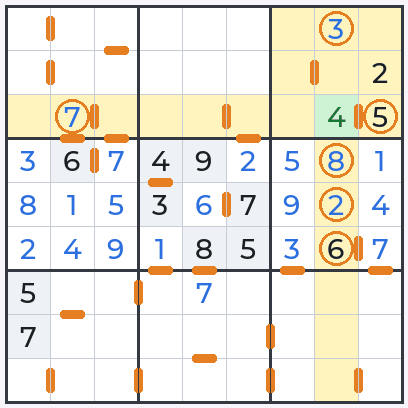

#### Step 24: r7c4

Column 4 has 1, 3 and 4; row 7 has 5 and 7. Not 6 or 8: it has no bar to the 7 in r7c5, so it isn't 6 or 8. Not 9: it has a bar to the 1 in r6c4, so it's 2. Only 2 is left: **r7c4 = 2**.

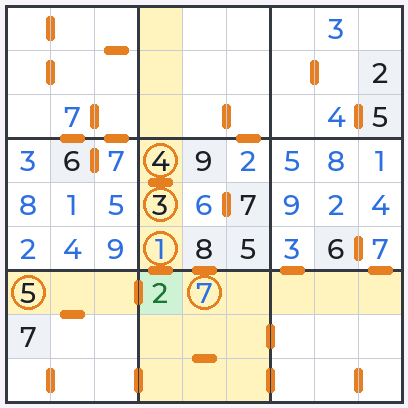

#### Step 25: the 2 in row 3

Row 3 needs a 2. r3c1: column 1 has one (r6c1). r3c4: column 4 has one (r7c4). r3c6: column 6 has one (r4c6). r3c7: box 3 has one (r2c9). r3c3: it has a bar to the 7 in r3c2, so it's 6 or 8. Only **r3c5** is left: **r3c5 = 2**.

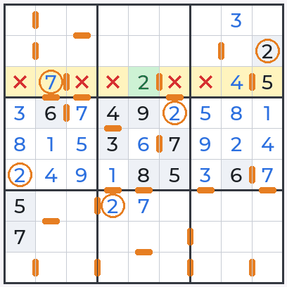

#### Step 26: the 3 in row 3

Row 3 needs a 3. r3c1: column 1 has one (r4c1). r3c4: column 4 has one (r5c4). r3c7: column 7 has one (r6c7). r3c3: it has a bar to the 7 in r3c2, so it's 6 or 8. Only **r3c6** is left: **r3c6 = 3**.

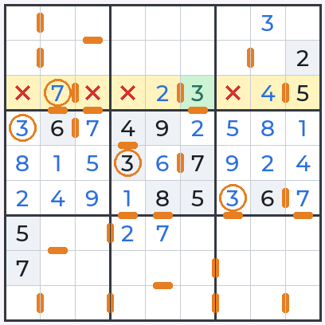

#### Step 27: the 3 in row 7

Row 7 needs a 3. r7c6: column 6 has one (r3c6). r7c7: column 7 has one (r6c7). r7c8: column 8 has one (r1c8). r7c2: it has no bar to the 4 in r6c2, so it isn't 3 or 5. r7c9: it has a bar to the 7 in r6c9, so it's 6 or 8. Only **r7c3** is left: **r7c3 = 3**.

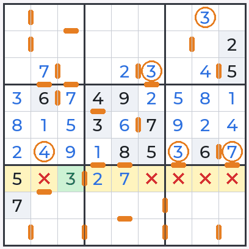

#### Step 28: the 3 in box 1

Box 1 needs a 3. r1c1, r1c2 and r1c3: row 1 has one (r1c8). r2c1: column 1 has one (r4c1). r2c3: column 3 has one (r7c3). r3c1 and r3c3: row 3 has one (r3c6). Only **r2c2** is left: **r2c2 = 3**.

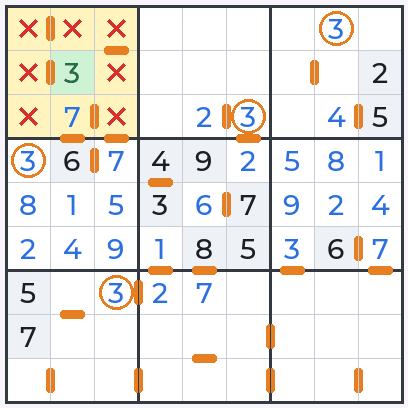

#### Step 29: the 2 in box 1

Box 1 needs a 2. r1c1: column 1 has one (r6c1). r2c1 and r2c3: row 2 has one (r2c9). r3c1 and r3c3: row 3 has one (r3c5). r1c2: it has no bar to the 3 in r2c2, so it isn't 2 or 4. Only **r1c3** is left: **r1c3 = 2**.

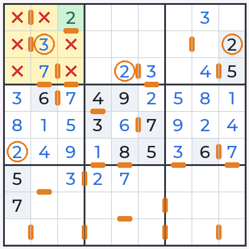

#### Step 30: the 5 in box 1

Box 1 needs a 5. r1c1 and r2c1: column 1 has one (r7c1). r2c3: column 3 has one (r5c3). r3c1 and r3c3: row 3 has one (r3c9). Only **r1c2** is left: **r1c2 = 5**.

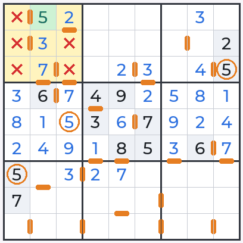

#### Step 31: the 8 in box 1

Box 1 needs an 8. r1c1, r2c1 and r3c1: column 1 has one (r5c1). r2c3: it has a bar to the 2 in r1c3, so it's 1 or 3. Only **r3c3** is left: **r3c3 = 8**.

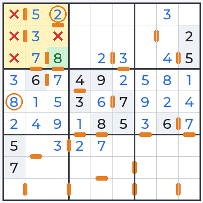

#### Step 32: the 6 in box 1

Box 1 needs a 6. r2c1: it has a bar to the 3 in r2c2, so it's 2 or 4. r2c3: it has a bar to the 2 in r1c3, so it's 1 or 3. r3c1: it has no bar to the 7 in r3c2, so it isn't 6 or 8. Only **r1c1** is left: **r1c1 = 6**.

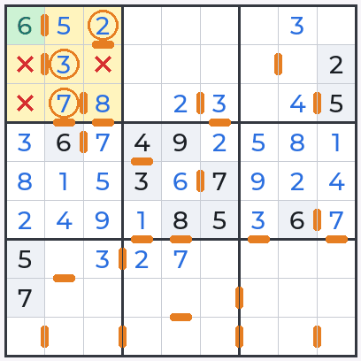

#### Step 33: the 4 in box 1

Box 1 needs a 4. r3c1: row 3 has one (r3c8). r2c3: it has no bar to the 3 in r2c2, so it isn't 2 or 4. Only **r2c1** is left: **r2c1 = 4**.

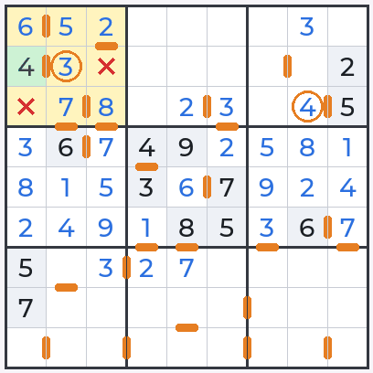

#### Step 34: the 9 in box 1

Box 1 needs a 9. r2c3: column 3 has one (r6c3). Only **r3c1** is left: **r3c1 = 9**.

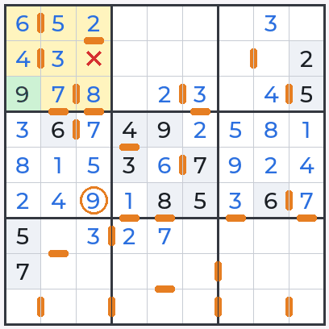

#### Step 35: the 1 in box 1

Box 1 needs a 1, and r2c3 is its last empty cell: **r2c3 = 1**.

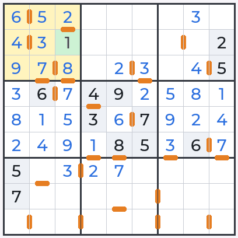

#### Step 36: the 6 in box 3

Box 3 needs a 6. r1c7 and r1c9: row 1 has one (r1c1). r2c8: column 8 has one (r6c8). r3c7: it has no bar to the 5 in r4c7, so it isn't 4 or 6. Only **r2c7** is left: **r2c7 = 6**.

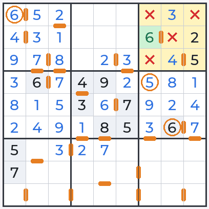

#### Step 37: the 6 in box 2

Box 2 needs a 6. r1c4, r1c5 and r1c6: row 1 has one (r1c1). r2c4, r2c5 and r2c6: row 2 has one (r2c7). Only **r3c4** is left: **r3c4 = 6**.

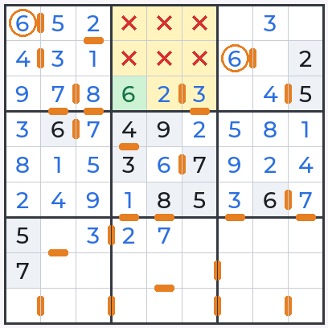

#### Step 38: the 5 in box 2

Box 2 needs a 5. r1c4, r1c5 and r1c6: row 1 has one (r1c2). r2c6: column 6 has one (r6c6). r2c4: it has no bar to the 6 in r3c4, so it isn't 5 or 7. Only **r2c5** is left: **r2c5 = 5**.

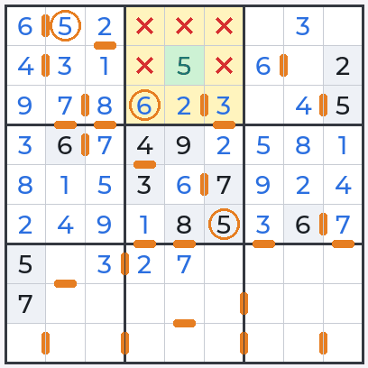

#### Step 39: the 4 in box 2

Box 2 needs a 4. r1c4: column 4 has one (r4c4). r2c4 and r2c6: row 2 has one (r2c1). r1c5: it has no bar to the 5 in r2c5, so it isn't 4 or 6. Only **r1c6** is left: **r1c6 = 4**.

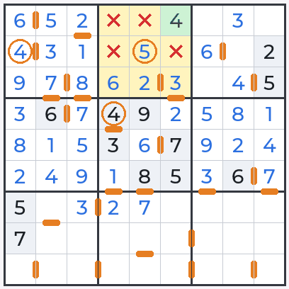

#### Step 40: the 1 in box 2

Box 2 needs a 1. r1c4: column 4 has one (r6c4). r2c4 and r2c6: row 2 has one (r2c3). Only **r1c5** is left: **r1c5 = 1**.

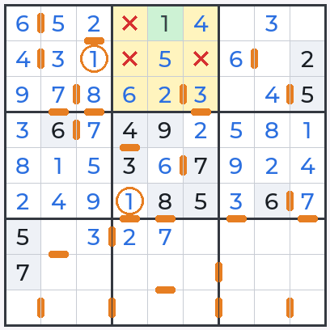

#### Step 41: the 7 in box 2

Box 2 needs a 7. r2c6: column 6 has one (r5c6). r2c4: it has no bar to the 6 in r3c4, so it isn't 5 or 7. Only **r1c4** is left: **r1c4 = 7**.

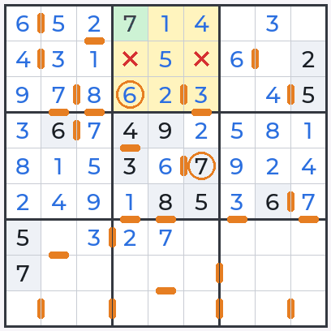

#### Step 42: the 8 in box 2

Box 2 needs an 8. r2c4: it has no bar to the 7 in r1c4, so it isn't 6 or 8. Only **r2c6** is left: **r2c6 = 8**.

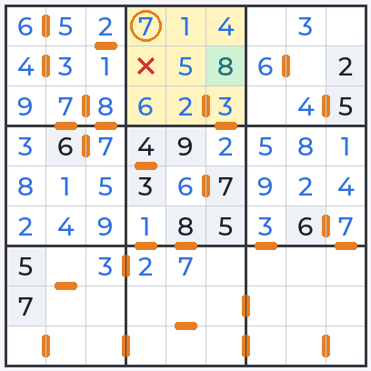

#### Step 43: the 9 in box 2

Box 2 needs a 9, and r2c4 is its last empty cell: **r2c4 = 9**.

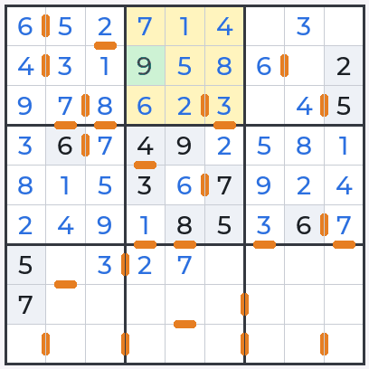

#### Step 44: the 1 in box 3

Box 3 needs a 1. r1c7 and r1c9: row 1 has one (r1c5). r2c8: row 2 has one (r2c3). Only **r3c7** is left: **r3c7 = 1**.

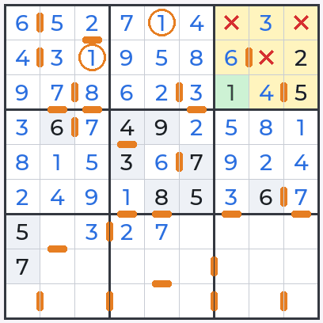

#### Step 45: the 7 in box 3

Box 3 needs a 7. r1c7 and r1c9: row 1 has one (r1c4). Only **r2c8** is left: **r2c8 = 7**.

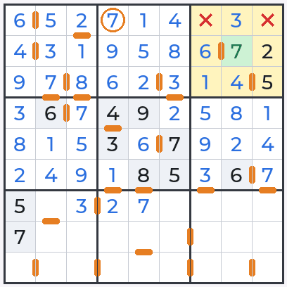

#### Step 46: the 9 in box 3

Box 3 needs a 9. r1c7: column 7 has one (r5c7). Only **r1c9** is left: **r1c9 = 9**.

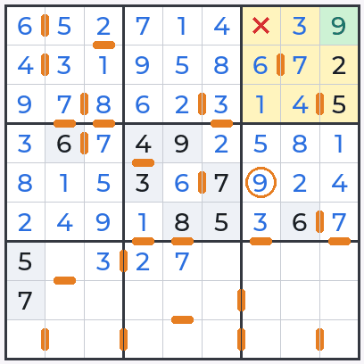

#### Step 47: the 8 in box 3

Box 3 needs an 8, and r1c7 is its last empty cell: **r1c7 = 8**.

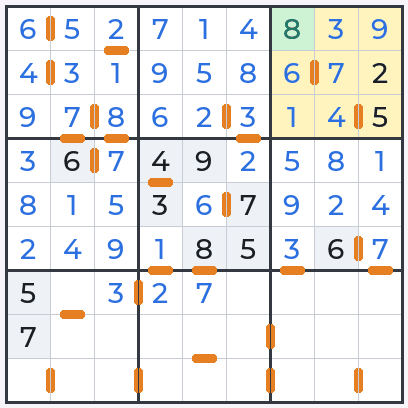

#### Step 48: the 1 in box 7

Box 7 needs a 1. r7c2, r8c2 and r9c2: column 2 has one (r5c2). r8c3 and r9c3: column 3 has one (r2c3). Only **r9c1** is left: **r9c1 = 1**.

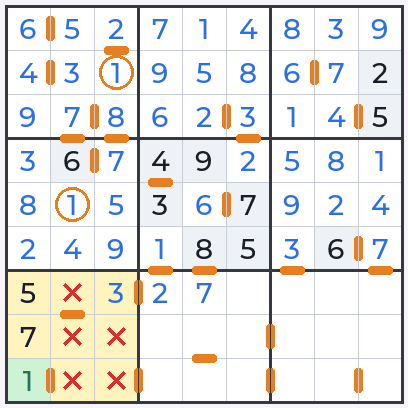

#### Step 49: the 4 in box 7

Box 7 needs a 4. r7c2, r8c2 and r9c2: column 2 has one (r6c2). r8c3: it has no bar to the 3 in r7c3, so it isn't 2 or 4. Only **r9c3** is left: **r9c3 = 4**.

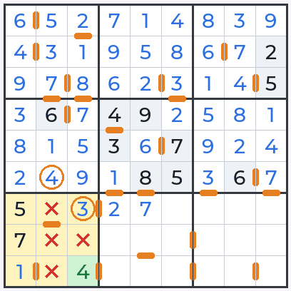

#### Step 50: the 6 in box 7

Box 7 needs a 6. r7c2, r8c2 and r9c2: column 2 has one (r4c2). Only **r8c3** is left: **r8c3 = 6**.

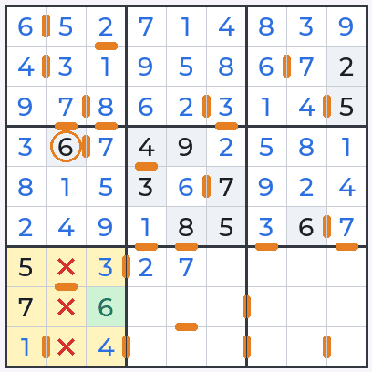

#### Step 51: the 8 in box 7

Box 7 needs an 8. r8c2: it has no bar to the 7 in r8c1, so it isn't 6 or 8. r9c2: it has a bar to the 1 in r9c1, so it's 2. Only **r7c2** is left: **r7c2 = 8**.


#### Step 52: the 2 in box 7

Box 7 needs a 2. r8c2: it has a bar to the 8 in r7c2, so it's 7 or 9. Only **r9c2** is left: **r9c2 = 2**.


#### Step 53: the 9 in box 7

Box 7 needs a 9, and r8c2 is its last empty cell: **r8c2 = 9**.


#### Step 54: the 4 in box 8

Box 8 needs a 4. r7c6 and r8c6: column 6 has one (r1c6). r8c4: column 4 has one (r4c4). r9c4, r9c5 and r9c6: row 9 has one (r9c3). Only **r8c5** is left: **r8c5 = 4**.


#### Step 55: the 3 in box 8

Box 8 needs a 3. r7c6: row 7 has one (r7c3). r8c4 and r9c4: column 4 has one (r5c4). r8c6 and r9c6: column 6 has one (r3c6). Only **r9c5** is left: **r9c5 = 3**.


#### Step 56: the 5 in box 8

Box 8 needs a 5. r7c6: row 7 has one (r7c1). r8c6 and r9c6: column 6 has one (r6c6). r8c4: it has no bar to the 6 in r8c3, so it isn't 5 or 7. Only **r9c4** is left: **r9c4 = 5**.


#### Step 57: the 6 in box 8

Box 8 needs a 6. r8c4 and r8c6: row 8 has one (r8c3). r7c6: it has no bar to the 7 in r7c5, so it isn't 6 or 8. Only **r9c6** is left: **r9c6 = 6**.


#### Step 58: the 8 in box 8

Box 8 needs an 8. r7c6: row 7 has one (r7c2). r8c6: column 6 has one (r2c6). Only **r8c4** is left: **r8c4 = 8**.


#### Step 59: the 9 in box 8

Box 8 needs a 9. r8c6: row 8 has one (r8c2). Only **r7c6** is left: **r7c6 = 9**.


#### Step 60: the 1 in box 8

Box 8 needs a 1, and r8c6 is its last empty cell: **r8c6 = 1**.


#### Step 61: the 1 in box 9

Box 9 needs a 1. r7c7: column 7 has one (r3c7). r7c9: column 9 has one (r4c9). r8c7, r8c8 and r8c9: row 8 has one (r8c6). r9c7, r9c8 and r9c9: row 9 has one (r9c1). Only **r7c8** is left: **r7c8 = 1**.


#### Step 62: the 2 in box 9

Box 9 needs a 2. r7c7 and r7c9: row 7 has one (r7c4). r8c8: column 8 has one (r5c8). r8c9: column 9 has one (r2c9). r9c7, r9c8 and r9c9: row 9 has one (r9c2). Only **r8c7** is left: **r8c7 = 2**.


#### Step 63: the 3 in box 9

Box 9 needs a 3. r7c7 and r7c9: row 7 has one (r7c3). r8c8: column 8 has one (r1c8). r9c7, r9c8 and r9c9: row 9 has one (r9c5). Only **r8c9** is left: **r8c9 = 3**.


#### Step 64: the 4 in box 9

Box 9 needs a 4. r7c9: column 9 has one (r5c9). r8c8: row 8 has one (r8c5). r9c7, r9c8 and r9c9: row 9 has one (r9c3). Only **r7c7** is left: **r7c7 = 4**.


#### Step 65: the 5 in box 9

Box 9 needs a 5. r7c9: row 7 has one (r7c1). r9c7, r9c8 and r9c9: row 9 has one (r9c4). Only **r8c8** is left: **r8c8 = 5**.


#### Step 66: the 6 in box 9

Box 9 needs a 6. r9c7, r9c8 and r9c9: row 9 has one (r9c6). Only **r7c9** is left: **r7c9 = 6**.


#### Step 67: the 7 in box 9

Box 9 needs a 7. r9c8: column 8 has one (r2c8). r9c9: column 9 has one (r6c9). Only **r9c7** is left: **r9c7 = 7**.


#### Step 68: the 8 in box 9

Box 9 needs an 8. r9c8: column 8 has one (r4c8). Only **r9c9** is left: **r9c9 = 8**.


#### Step 69: the 9 in box 9

Box 9 needs a 9, and r9c8 is its last empty cell: **r9c8 = 9**.


Solved.

<!-- /walkthrough -->
